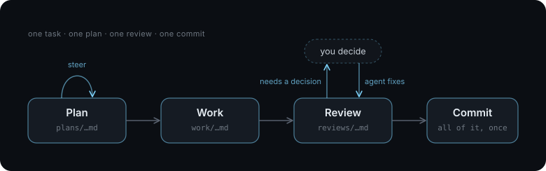
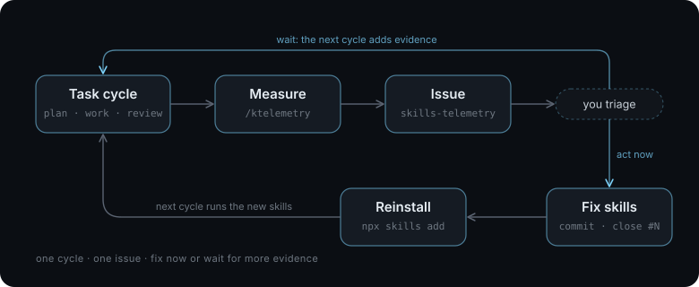
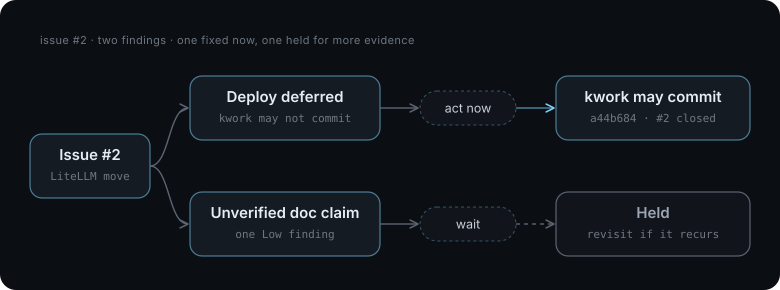

# The Improvement Loop

I use [this workflow](workflow.md):



Is it effective? Does planning produce better outcomes and fewer defects? Are my changes to the skills having the effect I wanted? How does token usage change as the skills change?

The improvement loop is a simple way to find out. After a task cycle, a skill measures how it went and files a report. I read the report and either fix the skills now or wait for more evidence.



## What I Collect

| Area           | Measurements                                                                                                                                         | Source                  |
| -------------- | ---------------------------------------------------------------------------------------------------------------------------------------------------- | ----------------------- |
| Skills         | A version hash for each skill                                                                                                                        | Installed skill files   |
| Code change    | Lines added and removed, files, test lines                                                                                                           | Git                     |
| Artifacts      | Size of the plan, work log, and review, and their size relative to the code change                                                                   | `agents/`               |
| Plan           | Tasks, test items, decisions, code references                                                                                                        | Plan                    |
| Work           | Departures from the plan, decisions, follow-up, checks run, manual verification                                                                      | Work log                |
| Review         | Findings by severity, category, and fix, coverage gaps, checks run                                                                                   | Review                  |
| Templates      | Missing sections, extra headings, template guidance left in                                                                                          | Artifacts and templates |
| Cost per stage | Model and effort, wall and active time, turns, prompts, questions, tool calls, subagents, compactions, and input, cache, output, and thinking tokens | Claude Code sessions    |
| Assessment     | Where each finding should have been caught, plan against outcome, suggested skill changes                                                            | The agent               |

## In Practice

One report raised two findings. A deploy had been deferred because the work skill was not allowed to commit, so that rule got an exception. A single unverified claim in the docs was a Low finding seen only once, so it waits until it shows up again.



## Add One to Your Own Skills

1. **Create a private repository for the reports.** Reports include project names, file paths, and session details, and only you need to read them.

   ```
   gh repo create skills-telemetry --private
   ```

2. **Write a skill that sends the report.** Only run it when you invoke it explicitly. Have it check access first and stop if it can't reach the repository, so it never posts anywhere else.

   ```markdown
   ---
   name: telemetry
   description: Measure a finished task cycle and file it as an issue in the private OWNER/skills-telemetry repository. Never use it unless the user invokes it.
   ---

   1. Run `gh repo view OWNER/skills-telemetry`. If it fails, stop.
   2. Read the plan, work log, review, and code change for `$ARGUMENTS`.
   3. Write the report: size and cost per stage, each finding and the stage that should have caught it, and one skill change that would have prevented it, or `None.`
   4. File it with `gh issue create -R OWNER/skills-telemetry`, and reply with the URL.
   ```

   ```
   /telemetry agents/plans/2026-10-16-001-export.md
   ```

3. **Measure with a script and judge with the agent.** The script counts what can be counted: artifact sizes, lines changed, and tokens, turns, and questions per stage from the session files. The agent adds what a script can't: where each finding should have been caught, how the plan compared with the outcome, and one concrete change to a skill.

   ```
   python3 scripts/telemetry.py measure agents/plans/2026-10-16-001-export.md > issue.md
   ```

4. **Record the skill versions.** Put a hash of each skill in the report, so you know which version produced it.

   ```markdown
   **Skills:** kplan `82504aeb406f` · kwork `07ef2704d692` · kreview `c15bbd3cc69e`
   ```

5. **Triage each report.** Fix a finding now when its cause is clear and the fix is small. Wait when it has happened only once. A rule added for a one-off makes every future session longer.

   ```
   Read OWNER/skills-telemetry#2. Fix what's worth fixing now, and tell me what should wait for more evidence.
   ```

6. **Close the loop.** Commit the fix, close the issue with a link to the commit and a summary of what was addressed and what was held, and reinstall the skills.

   ```
   Commit, push, close the issue with a link to the commit and a summary, then reinstall the skills.
   ```

For a tool rather than a set of skills, the tool's skill can file the report itself at the end of every run. The gnat skill does this. It files a feedback issue on gnat's own repository, and reads the open feedback issues first so it reports only what's new.

See [`skills/ktelemetry`](../skills/ktelemetry/SKILL.md) for a working example.
