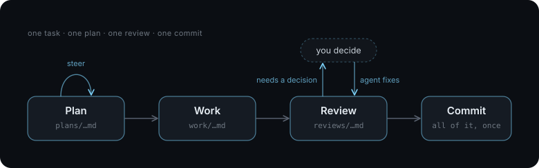

# An Agentic Development Workflow

> The ability to simplify means to eliminate the unnecessary so that the necessary may speak.<br>— Hans Hofmann

This workflow assumes the developer roughly knows what they want to build, is prepared to make the architectural decisions, and cares about the code.

There are no agent swarms here -- no worktrees. This is just you, an agent harness, your code, a couple files, and a few agent skills; working carefully on one thing at a time.

Don't forget:

- This stuff changes _fast_. This is my workflow today. It probably won't be my workflow tomorrow. Stay nimble.
- Do what works for you, your team, and your project.
- Don't believe the hype. Nobody has this figured out yet. Use agents to write code, read that code, and form your own opinions.

## Overview

Each task should be a session-sized unit of work: reasonably self-contained, so the project builds once it's done, and meaningfully testable.

For each task, the agent writes a plan, implements it, and reviews the changes. You review the plan and make any decisions the agent raises, then commit the plan, code, work log, and review together.

The skills write their files to `agents/`, which keeps the workflow's records together and out of the way of the code.



## The Workflow

### 1. Plan

```
/kplan add CSV export
```

Give the plan skill a task. The agent explores the codebase, works through any open design decisions with you, and writes an implementation plan to `agents/plans/`.

Planning upfront forces the agent to confront edge cases before writing code and lets you steer the design before bad code is written.

### 2. Work

```
/kwork agents/plans/2026-10-16-001-export.md
```

Once the plan looks right, the work skill takes over. The agent implements the plan, runs the checks, and writes a work log to `agents/work/` recording how the change was verified, where it departed from the plan, and any surprises it ran into.

### 3. Review

```
/kreview staged changes for agents/plans/2026-10-16-001-export.md
```

After the implementation is done, the review skill checks it. The agent reviews the changes against the plan, fixes trivial issues directly, and asks you to decide on anything non-trivial. It writes the review to `agents/reviews/`, with the findings and how each was resolved, and stages it with the fixes.

### 4. Commit

Read the staged changes and commit the plan, code changes, work log, and review together.

### Variations

To get a second opinion on a plan, run the discuss skill between planning and work:

```
/kdiscuss codex agents/plans/2026-10-16-001-export.md
```

The agent discusses the plan with another agent (Claude Code, Codex, or OpenCode) for up to six replies. It updates the plan with the improvements they agree on and reports any questions left unresolved.

To understand a change before you commit it, run the explain skill after the review:

```
/kexplain staged changes
```

The agent writes a self-contained HTML page to `agents/explanations/` that walks through the change with prose, code, diagrams, and other visual aids: what changed, how it fits into the rest of the system, and how things worked before compared to how they work now. It also works on changes you've already committed, such as `/kexplain the last commit`.

To carry a task from plan to commit without stopping for input, use the auto skill:

```
/kauto add CSV export
```

The agent runs the plan, work, and review skills in sequence, makes the decisions they would ask you about, and commits. Its final response lists each design decision it made, with the reason.

### Consistent Responses

Each skill has a **Final response** section that specifies the format and information the assistant should include when it finishes. The response summarizes the result and links to the files it produced. Depending on the skill, it also calls out decisions, surprises, or review findings. The plan, work, and review skills include the next command to run.

I've found this consistency really nice. I know where to look for the result, what needs my attention, and which command to run next.

## Examples

Here are a few projects built with this workflow. Their repositories show what the generated plans, work logs, reviews, and commit histories look like in practice:

- **[Ox](https://github.com/kkestell/ox)**: An ACP-native coding agent in Go, with an ACP server and a terminal UI.
- **[Willow](https://github.com/kkestell/willow)**: A small, statically typed language with Python-like syntax that compiles to Lua and runs on LuaJIT.

## `AGENTS.md`

> The more you tighten your grip, Tarkin, the more star systems will slip through your fingers.<br>— Princess Leia Organa

`AGENTS.md` sits at the root of the repository and holds the project's standing instructions for the agent: what the project is, how to run the checks, and a few rules about style, documentation, and communication.

Keep `AGENTS.md` short. The agent reads these instructions on every task, so every rule takes attention away from the code and the problem you're trying to solve. A long list also makes it harder for you to tell which rules are helping.

Many rules are workarounds for quirks in a particular model. The next model may handle those things on its own, but the old rules tend to stick around. Over time, you can end up with instructions that mostly tell the agent what it would have done anyway. Start with very few, read the code it produces, and add rules when you see recurring problems. Revisit those rules when you change models.

Here's an example:

````markdown
# Project

Describe your project in one sentence.

## Commands

- `npm run lint` runs every check.
- ...

## Workspace

```text
.
├── AGENTS.md
├── agents/
│   ├── plans/          # Implementation plans
│   ├── work/           # Work logs and verification results
│   ├── reviews/        # Code reviews and finding resolutions
│   └── explanations/   # HTML walkthroughs of changes
├── src/
└── tests/
```

## Style

- Do less. Keep correct code simple, idiomatic, and cheap to change.
- Give each concern a clear boundary and each lifecycle one owner.
- Solve the actual problem. Every addition must justify its complexity; producing more code is not a goal. When both a simple solution and a general solution work, choose the simple one and wait for evidence before generalizing.
- Test observable behavior. Use a small number of representative examples and meaningful regression tests for actual bugs.

## Documentation

- Give each fact a single source of truth.
- The code and its comments describe the implementation. Git history records changes.
- Most code needs no comments. Most changes need no documentation updates.
- Do not create new documentation files or sections unless requested.
- Code, comments, and test names describe the project in its own terms. Never mention roadmap milestones, ticket numbers, plans, or other work records in them.

## Communication

- Describe things directly, clearly, and plainly. Lead with the main point, then add detail as needed.
- Avoid jargon, invented terms, and shorthand. Never mix definitions or overload terms.
- Explain what changed and how it was verified. Be short. Say the thing and stop.
````

The documentation rules keep agents from filling the repository with explanations of code they just wrote. Left alone, agents often produce summaries, walkthroughs, and other documents that mostly restate the implementation. Those files cost tokens to write and read, need updating when the code changes, and can mislead the next session when they fall out of date. The agent can read the code directly, so removing documentation that merely repeats it usually doesn't make its work any worse.

## Models, Harnesses, and Sessions

The skills are written to work across Claude Code, Codex, and OpenCode, so you can switch harnesses and models without changing the workflow. You don't have to use the same model for every step. You might use a stronger model to work through the design, then a cheaper, faster one to implement the plan.

It's worth using a different model for review. The model that wrote the code may repeat the assumptions it made during implementation; another model may question those assumptions or catch mistakes the first one missed. You still need to read the code and judge the findings yourself.

The plan, work, and review can all happen in a single session, as long as you keep an eye on the context window. Other times it makes sense to run each in a fresh session. The trade-off is that the agent has to reorient itself at the start of every fresh session. Prefix caching makes long sessions much, much cheaper than they look.

For Claude Code settings I use, see [Claude Code Tips and Tricks](claude-code-tips.md).
